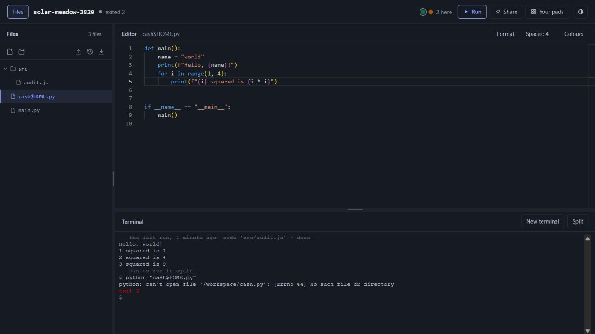
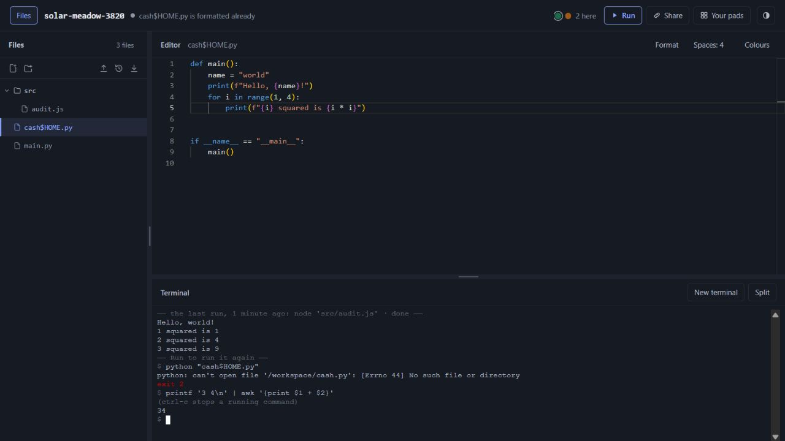

# Pad: production audit and critical product assessment

**Audited 17 October 2026. Overall assessment: 5/10 today; credible potential of 9/10 as a focused collaborative code scratchpad.** The normal experience is useful and cohesive. It is not yet dependable enough to promise that shared work cannot be lost, private execution is fully isolated, or every accepted command produces the correct result. The most consequential work is data integrity, isolation and recovery, followed by compatibility and performance.

This audit identified reproducible defects, security and operational risks, and explicit limits to the evidence. It did not prove the absence of other defects. “Zero errors for every user and every action” is not a claim that finite testing can establish. The appropriate release standard is a defined supported matrix, measurable reliability objectives, safe failure behavior, and regression tests for every reproduced failure class.

No product implementation was changed or deployed. The audit uses the current checkout `b65533f`, the live application at [code.rishwanth.dev](https://code.rishwanth.dev), public deployed assets, bounded synthetic production journeys, and controlled local reproductions. Existing modifications in the older September review documents were preserved.

## Read the evidence

The following four reports contain reproduction steps, source locations, observed results, fixes and remaining limitations:

| Report | Contents |
|---|---|
| [Data integrity and collaboration](data-collaboration.md) | Concurrent editing, imports, moves, conflict handling, offline recovery, response deadlines, ZIP inflation, document identity and preview routing. |
| [Backend, security and operations](backend.md) | Authorization, WebSockets, storage limits, slow requests, historical reads, expiry, secret logging, durability, backups and deployment. |
| [Runtime and automated quality](runtime-quality.md) | Deployed suite results, command correctness, filename quoting, runtime retries, process state, dependencies and test coverage. |
| [Live user journeys and UX](live-ux.md) | Manual production checklist, screenshots, accessibility, name-dialog race, product experience and explicit coverage gaps. |

Supporting JSON, repro scripts and raw logs are beside these reports and in `logs/`. Screenshots show the actual deployed browser, not mockups.

## Final execution results

| Check | Final outcome |
|---|---|
| Deployed user journeys | **110 checks passed**, zero page errors; includes interactive input, stopping, file operations, persistence, packages, scientific plotting and server preview. |
| Deployed preview suite | **28 checks passed**; includes cross-port requests, cookies, pop-out, service-worker recovery and server restart. |
| Current-source relay unit tests | **153 passed, 0 failed, 0 ignored**. |
| Typecheck and production builds | Passed across the workspaces after repairing the local dependency installation. |
| Fresh app-check | Failed on its first runtime start after four preliminary passes; download failure and 180-second timeout recorded. Other fresh starts succeeded. |
| Targeted backend fault probes | Nine scenarios produced 11 evidence records: authorization fail-open, foreign Origin, logout/expiry, stalled uploads, storage accounting, operation scaling, history memory and expiry. An additional missing-database restart experiment failed to start the local relay and is **inconclusive**; the harness therefore exited 1. |
| Targeted frontend/runtime reproductions | Data-loss, routing, command-correctness and recovery defects reproduced with the actual implementation; the detailed reports distinguish production observations from controlled tests. |
| Dependency advisory scan | Two moderate affected package groups, zero high/critical; no demonstrated live XSS. |
| One cold and one warm performance visit | Cold editor visible **4.62 s**, Run-to-output **21.77 s**; warm editor visible **2.04 s**, Run-to-output **2.20 s**. A second warm run took **0.68 s**; observed autosave **0.75 s**. These are individual desktop samples, not population percentiles. |

Raw results: `logs/live-user-check.log`, `logs/live-preview-check.log`, `backend-unit-tests.txt`, `backend-probe-results.jsonl`, `backend-probe-stderr.txt`, and `logs/pad-visit.jsonl`. A passing broad suite and a failing targeted edge case can both be correct: the broad suite does not cover every interleaving or failure mode.

## What the audit establishes

Evidence is deliberately separated into four levels:

1. **Live observation:** an action was performed against the deployed product and its result observed. Examples: valid Python filename fails; awk returns wrong arithmetic; fresh automated runtime start fails; ordinary Python/JavaScript/preview flows pass.
2. **Local reproduction of real implementation:** actual application methods, modules or server code were run with controlled inputs. Some use realistic doubles for network, DOM or filesystem behavior. These prove the faulty code path, not its frequency among real users.
3. **Source/configuration finding:** a problematic policy, resource bound, persistence protocol or missing guard is established from code/configuration. Its production trigger may not have been exercised.
4. **Unverified risk or missing capability:** a credible concern or coverage gap that needs another experiment. These are not counted as observed production failures.

The deployed preview worker matched the reviewed source exactly after line-ending normalization. Relevant frontend methods were also matched in captured deployed bundles. The merge and both document-identity hash functions were extracted from the deployed helper bundle and executed locally, reproducing the same corruption and collisions; its response-deadline and ZIP-inflation ordering also matches the reviewed source. These checks establish specific deployed-code exposure, not complete build identity or an end-to-end production reproduction of every finding. The inspected backend endpoint does not identify its deployed commit; backend tests describe the current source unless explicitly labelled live.

## The most important findings

| Priority | Finding | What a user or operator can experience | Evidence |
|---|---|---|---|
| Release blocker | Concurrent ZIP replacement can be undone by a collaborator's next keystroke | Imported content silently disappears after a successful import. | DC-01: actual App-method reproduction. |
| Release blocker | Overlapping folder move deletes a descendant | UI reports a successful move while a file is gone. | DC-02: actual App-method reproduction; matching deployed move logic. |
| Release blocker | A rejected stale edit is retried as an unconditional overwrite | Another user's edit is discarded and status says saved. | DC-03: actual App-method reproduction; matching deployed fallback. |
| Release blocker | Quota failures drop dirty bookkeeping; editor drafts have no durable recovery | Work stays visible in memory but is not saved/retried and can be lost on close or later transitions. | DC-04 reproduced; DC-05 source/deployed unload logic. |
| Release blocker | Preview navigation uses a global active session | A navigation or form can reach another open preview's server. | DC-10: actual worker VM; deployed worker equality. |
| Release blocker | Authorization database errors become anonymous editor grants | Private content may become readable/writable during a storage fault. | B01; backend probe status in backend report. |
| Release blocker | Cookie-authenticated WebSocket lacks Origin validation | Untrusted same-site preview content may act through an owner's live-room permissions. | B02; separate backend proof from the unperformed complete browser exploit. |
| Release blocker | No verified off-volume backup/restore | A disk/account/operator incident can remove every pad and account, including in-product history. | B08; explicit same-day durability documentation, no cloud inventory inspected. |
| High | History reads bypass normal streaming and read admission | Ordinary historical reads can amplify memory use and take down the shared relay under concurrency. | B03; local probe/source evidence, no production stress. |
| High | Two incomplete uploads can retain both global write permits | Everyone else's saves queue behind clients that never finish sending. | B04; bounded local probe/source evidence. |
| High correctness | awk performs string operations where arithmetic is expected | `3 + 4` produces `34` with a successful exit. Silent wrong answers undermine trust in data work. | R1: live and differential reproduction. |
| High for affected users | Terminal output lacks the screen-reader DOM representation | Program results and errors visible on screen are absent from the accessible terminal surface. | UX1: live tree + source + versioned xterm defaults; actual AT session still needed. |

“Release blocker” here means a blocker to advertising the product as dependable for valuable/private shared work. It does not mean every casual session fails or that exploitation has occurred.

Two directly observed failures:

The Python starter is valid. The filename is accepted by Pad. The Run command expands the dollar expression, so it opens the wrong path.

The command returns a plausible but incorrect number and does not report an unsupported operation.

## Full findings index

The IDs below are stable references into the detailed reports. Related findings are kept distinct when their trigger or remediation differs; source risks are not inflated into extra live bugs.

| ID | Severity | Finding |
|---|---|---|
| DC-01 | P1 | ZIP replacement does not reconcile a document open in another client. |
| DC-02 | P1 | Folder move source/destination overlap deletes a moved file. |
| DC-03 | P1 | HTTP 409 recovery overwrites the newer server version. |
| DC-04 | P1 | HTTP 413/507 drops unsaved bookkeeping. |
| DC-05 | P1 | No persistent draft journal or editor leave warning for unsaved work. |
| DC-06 | P2 | Coarse three-way merge duplicates code under nonadjacent edits. |
| DC-07 | P2 | Save deadline ends at headers, leaving stalled bodies outside the timeout. |
| DC-08 | P2 | ZIP inflation limit is checked after full decompression/allocation. |
| DC-09 | P2 | Path-hash collisions route updates into another file; seed-hash collisions leave divergent documents. |
| DC-10 | P1 | Preview navigations can route to another open session. |
| DC-11 | P2 | Untrusted preview pages can issue worker control messages. |
| DC-12 / R8 | P2 conditional | A listed but unreadable runtime file is interpreted as a deletion; one defect independently reproduced by both workstreams. |
| B01 | High | Account lookup failure grants anonymous editor access. |
| B02 | High | Owner-authenticated WebSocket accepts foreign Origin. |
| B03 | High | Historical reads bypass streamed-read and concurrency protections. |
| B04 | High | Two incomplete request bodies can block all saves. |
| B05 | Medium | Custom bearer-code header is not redacted by the checked-in access-log configuration. |
| B06 | Medium | Owner WebSockets outlive expiry; a delayed room join also bypasses logout eviction. |
| B07 | Medium | Acknowledged writes do not establish power-loss-safe blob/database ordering. |
| B08 | High operational | No verified backup and rehearsed restore. |
| B09 | Medium | Global storage accounting omits database-resident output and metadata. |
| B10 | Medium | Unbounded operation count reaches quadratic processing while holding a write permit. |
| B11 | Low/medium | Expired anonymous history remains readable before the sweep. |
| B12 | Medium operational | Nonatomic release copy and shallow health check do not prove Pad readiness. |
| R1 | P1 | awk field arithmetic silently computes wrong results. |
| R2 | P2 | Python Run shell-expands valid filenames. |
| R3 | P2 | sort accepts cases/options that silently alter data or ordering. |
| R4 | P2 | awk regex field separators are treated literally. |
| R5 | P2 | Quote-blind toolchain detection causes unwanted downloads and misses valid commands. |
| R6 | P2 | Failed runtime initialization remains cached and cannot retry normally. |
| R7 | P2 | Program output can impersonate terminal command completion. |
| R9 | P2 | Failed requirements installation is marked attempted/installed and skipped subsequently. |
| UX1 | P1 for affected users | Terminal screen-reader support is disabled. |
| UX2 | P2 | Stale name-availability response disables creation after the field is cleared. |

Additional follow-ups are intentionally not treated as proven end-to-end defects: deletion/permission races, account/store quota reconciliation, anonymous-name claim races, viewer-generated binary export, partial multi-request imports, handshake memory bounds, aggregate socket limits, and resource pressure from many terminals. Their conditions and limits are in the detailed reports.

## Product scorecard

These are critical engineering/product judgments, not measured uptime percentages, market research, or a mathematical guarantee. “Attainable” assumes the listed failures are fixed and the missing verification is performed. A smaller dependable feature set is worth more than a larger command list that sometimes returns wrong answers.

| Dimension | Current /10 | Attainable /10 | Assessment |
|---|---:|---:|---|
| Product concept and immediate usefulness | 8 | 9 | URL → editable code → Run → shared result is a strong, understandable workflow. |
| Everyday interaction and visual coherence | 8 | 9 | Compact UI, integrated starters/formatting/terminal/preview; constraints and recovery need better disclosure. |
| Runtime and command correctness | 5 | 8 | Useful real execution, but shims, quoting, process completion and retry semantics are uneven. |
| Shared editing and file operations | 4 | 9 | Healthy live typing is supported; imports, conflict fallback and overlapping moves can corrupt the shared result. |
| Data preservation and failure recovery | 3 | 9 | Unsaved journals, conflict recovery, durable acknowledgment and tested backup are missing or incomplete. |
| Security and permission isolation | 4 | 9 | Good foundations are undermined by fail-open error handling and preview/WebSocket boundaries. |
| First-use reliability | 5 | 8 | Successful manual starts coexist with a failed fresh automated start; retry behavior makes transient faults worse. |
| Performance and resource efficiency | 5 | 8 | Caching and package mirroring help; large cold toolchains and full-filesystem scans require real budgets/benchmarks. |
| Accessibility | 3 | 8 | Labelled controls and keyboard support help; inaccessible terminal output blocks a central task. |
| Browser/device confidence | 4 | 8 | Chromium evidence exists; real Safari/Firefox/mobile/lifecycle/IME coverage is missing. This scores confidence, not a proven failure on every other browser. |
| Operations and disaster recovery | 3 | 9 | Bounded services and documented deployment exist; recovery, release atomicity and actual usability checks need work. |
| Automated testing and engineering discipline | 7 | 9 | Broad regression suites and documented failure history; new fault combinations and compatibility edges escape them. |
| Maintainability | 6 | 8 | Strong explanatory code; a large App coordinator and multiple interacting synchronization/state paths increase regression risk. |
| Documentation and expectation setting | 6 | 9 | Detailed maintainer docs, but some implementation claims and in-product assumptions exceed verified behavior. |

**Overall: 5/10 now, with 9/10 potential in the intended niche.** This is not an average that allows an attractive UI to cancel data loss. Security, preservation and recovery cap the overall rating. For disposable snippets and demonstrations, usefulness is already closer to 7–8/10. For important collaborative work where losing edits is unacceptable, current readiness is closer to 3–4/10.

As a general replacement for a local development machine, the ceiling is lower: WASIX/package/thread/network/runtime constraints are structural. Pad can become excellent by defining and reliably supporting its own use cases, without implying arbitrary Linux/CPython/Node toolchain parity.

## What is worth preserving

- Very low friction for the first useful action; no account is required to try it.
- Computation runs in the visitor's browser, reducing the server's compute burden and enabling interactive examples without a remote development machine.
- A coherent workspace with an editor, file tree, terminals, starter code, formatting and useful run diagnostics.
- Last-run persistence makes a shared example understandable before the recipient runs it.
- CRDT editing, presence, explicit viewer/editor/owner roles and revocable links are substantial foundations.
- Preview has request and console inspection, which is more useful than a simple embedded webpage.
- ZIP portability, binary handling, history and recovery hooks show attention to real work rather than only a demo.
- The code and review history explain past failures, tradeoffs and test intent unusually well.
- OAuth state/PKCE, secure cookies, hashed bearer tokens, server-side role enforcement, path checks, bounded normal reads and service hardening are already present.

These strengths explain the high potential rating. They also make the remaining weaknesses more consequential: users can already do enough useful work here to trust it with something they would regret losing.

## Scope and coverage matrix

| Area | Covered during this audit | Not established |
|---|---|---|
| Anonymous workflow | Live creation, edit/run, files, starters, format, share, persistence, last run, terminals and preview; existing live user suite | Every action combination, all quotas, all undo/redo interleavings. |
| Accounts | Live signed-out screens, unauthorized API behavior, provider entry redirects and secure state-cookie flags; backend source/local probes | Real Google/GitHub completion, real production owner/editor/viewer accounts, live account deletion and recovery. |
| Collaboration | Live presence and saved-state visibility; targeted real implementation reproductions | Every network partition, simultaneous import/move/delete, multi-hour multi-user soak. |
| Data safety | Fault-injected save/conflict/import/move/ZIP tests, persistence design review | Real browser crash/eviction recovery; physical power loss; production backup restoration. |
| Runtime | Live Python/JS, command/terminal user checks, reference-tool differential tests, parser/state probes | Exhaustive language/package/ABI parity; every compiler; all child-process termination trees. |
| Preview/security | Live basic server and diagnostics, real worker VM tests, deployed worker equality, backend/source boundary review | Complete authenticated browser exploit chain; production security load testing. |
| Performance | One cold and one warm desktop browser visit with runtime/terminal/autosave timings, actual failed cold start, bounded local resource probes, source complexity review | Representative p50/p95/p99 latency, low-end phone memory, weak-network matrix, sustainable concurrent-user capacity. |
| Accessibility | Live accessibility tree and source review, screen-reader-mode finding | NVDA/VoiceOver user journey, full keyboard/zoom/touch/IME audit, formal conformance. |
| Operations | Source/configuration review and documented recovery state | Production logs/cloud controls/backup inventory, incident drill, real rollout/rollback under traffic. |
| Dependencies | Production npm advisory scan, without automatic fixes | Proof that every advisory is reachable; Rust supply-chain audit or SBOM attestation. |

## Remediation order and acceptance criteria

### 1. Protect permission and data boundaries before expanding usage

Fail closed on permission-store errors. Validate cookie-authenticated WebSocket origins. Bind preview routing and control messages to a verified session/client. Make imports, moves and restores reconcile all live documents. On a 409, merge or retain a recoverable conflict; never convert a failed conditional update into an unconditional overwrite.

Acceptance: two isolated clients with disagreeing state, including a disconnected live channel, cannot silently lose either user's edit; a fresh reload agrees with the displayed saved result. A preview document cannot claim control or cause a request to run in another session. Foreign-origin credentialed WebSocket tests must fail even when the caller possesses a valid browser session cookie in the controlled test environment.

### 2. Make “saved” and “recoverable” defensible promises

Retain unsaved bookkeeping on every failure. Add a local durable draft journal with clear saved/pending/failed indicators and an export/recovery path. Extend network deadlines through body consumption. Define acknowledgment durability and enforce blob/database ordering. Implement consistent backups, off-volume retention, alerts and a tested restore including account metadata and required keys.

Acceptance: forced offline close, reload, tab crash, quota failure and response-body stall preserve the user's work; reconnect either saves it or presents an explicit conflict. Restore a known pad/account set to an isolated instance and verify file hashes, permissions, links and history. Publish measured recovery point and recovery time objectives rather than saying “kept forever.”

### 3. Bound shared resources and make deployments recoverable

Give historical reads the same streaming/admission guarantees as ordinary reads. Bound upload body time and permit wait, operation counts, database-resident storage and socket memory. Redact bearer headers. Stage releases atomically, retain assets needed by open clients, smoke-test actual Pad/preview/runtime behavior, and provide rollback.

Acceptance: bounded slow-client tests cannot hold all write capacity indefinitely; historical reads fit the service memory limit; the storage ceiling includes metadata/output and leaves physical disk reserve; an interrupted deploy and a failed new build can be rolled back without losing data.

### 4. Make accepted runtime behavior correct and failures retryable

Use proper shell-word escaping for every file path. Differential-test supported awk/sort syntax. Separate process completion from program stdout. Reset failed initialization state and offer retry. Preserve the distinction between nonexistent and unreadable files. Mark requirements successful only after installation succeeds. Parse command syntax accurately enough to avoid massive incidental downloads.

Acceptance: the reproductions in this audit become permanent failing-before/passing-after regression cases, including a post-action reload/store verification. Unsupported syntax should produce an explicit message rather than a plausible wrong result.

### 5. Establish the supported product matrix

Enable accessible terminal output and test with real assistive technology. Add WebKit, Firefox and real mobile lifecycle checks. Define supported languages/packages and clearly surface their limits. Measure editor-ready, first-output, reconnect-to-saved, import/export, large-pad command completion and memory under cold/warm/weak-network conditions.

Acceptance: publish the browsers/devices/features that were actually tested; attach measurable budgets and a release gate. Track production failure rates and recovery success with privacy-conscious telemetry. The goal is not a longer feature list; it is a trustworthy supported experience.

## Audit artifacts and remaining state

The manual audit pad is `solar-meadow-3820`; the automated cold-start failure used `dusky-canyon-5391`. Automated suites may create additional synthetic pads identified in their logs. These contain test content only. No production customer content was used for fault tests. The audit did not delete accounts, change sharing on existing pads, rotate credentials, deploy fixes or run denial-of-service probes against production.

The workspace's initial dependencies were stale. Test setup repaired the lockfile-defined installation; environment failures are recorded separately from product defects. Compiler/build and suite outcomes are recorded in the detailed runtime/backend reports and raw logs. Passing a typecheck or a broad user suite does not negate the separate failing edge-case reproductions.
